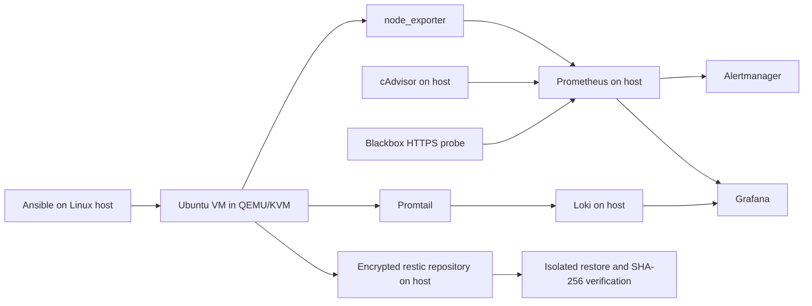

# Linux SRE Observability Kit

A disposable Ubuntu 24.04 VM with Ansible hardening, metrics, logs, alerts,
encrypted backups, and an isolated restore drill. The monitoring stack runs on
the Linux operator host; the guest remains a small, independently recoverable server.

**Status:** implementation available; offline configuration checks passed. Live
acceptance and GitHub CI results are not yet available. See [validation results](docs/results.md).

## Architecture



## Requirements

- Linux x86_64 with readable/writable `/dev/kvm`, about 6 GiB spare RAM and 15 GiB disk.
- Docker Engine and Compose with permission to use the Docker socket.
- Python 3.11+, venv, make, curl, OpenSSH, OpenSSL, QEMU, xorriso.
- Internet access for the Ubuntu image, apt packages, Python packages, and container images.
- Free loopback ports: 2222, 19100, 18080, 3000, 3100, 9090, 9093, 9115, 18000, 18081.

For Ubuntu operators, install host tools with:

```bash
sudo apt-get update
sudo apt-get install make python3-venv qemu-system-x86 qemu-utils xorriso curl openssh-client openssl
```

Install Docker Engine and its Compose plugin separately. Confirm `docker ps`
and access to `/dev/kvm` work as your user before starting.

## Quickstart

```bash
make setup
make vm
make provision                 # starts monitoring, generates secrets, then applies Ansible
make verify                    # includes a real HostDown alert and backup/restore drill
```

Grafana: <http://127.0.0.1:3000>, username `admin`. Read its generated password:

```bash
cat .cache/secrets/grafana-password
```

The **Linux SRE Lab** dashboard is provisioned automatically. Prometheus is at
<http://127.0.0.1:9090>; Alertmanager is at <http://127.0.0.1:9093>.
Alerts are visible locally; no email or chat notification is configured.

```bash
make backup
make restore-drill
make check test                # offline configuration validation
make stop                      # retain VM disk and Docker volumes
make destroy                   # remove VM disk; retain backup and monitoring volumes
```

`make verify` deliberately stops node_exporter and always attempts to restart it.
It requires successful external HTTPS probing as well as the local stack.
It writes measured timings to `.cache/results.json`; failed runs do not publish a success report.

## Hardening and recovery

Ansible disables password/root SSH login, enables an nftables default-drop input
policy, configures fail2ban and unattended upgrades, limits the journal, and
creates an unprivileged application account. Cloud-init creates the key-only
administrator. Never target a production machine with this inventory.

Backups include `/etc`, `/home`, `/srv` and ordinary logs. Credentials and binary
journals are excluded. A daily systemd timer invokes restic. The repository
server is append-only; automatic pruning is deliberately absent.
The restore drill selects the recorded successful snapshot, restores into a
fresh directory, verifies restic content and SHA-256 hashes, then removes that directory.
It never overwrites live paths. This proves selected file recovery, not bare-metal recovery.

The operator owns the encryption password in `.cache/secrets/restic-password`.
Keep an independent secure copy: deleting it makes encrypted backups unusable.
The repository is a Docker volume on the same host, so host loss requires an
additional off-host copy. Review [security](docs/security-checklist.md).

## Alerts and operations

CPU, memory, disk, exporter availability, missing/stale/failed backups, failed
restores, HTTPS availability and TLS expiry are covered. The example HTTPS target
is `https://example.com`; edit `monitoring/prometheus/prometheus.yml` for your service.
See [runbooks](docs/runbook.md), [architecture](docs/architecture.md), and
[validation results](docs/results.md).

## Limits

This is a local Linux lab, not a hardened production observability deployment.
Containers use host networking and bind loopback. cAdvisor has privileged host
access and observes the operator's containers. Use a dedicated lab host.
SSH host-key checking is disabled only for the disposable VM. Default inventory
ports are fixed; changing VM port variables requires matching inventory and scrape edits.
Promtail is retained from the initial implementation as a legacy log agent;
review its support status and migrate before production use. Dependency versions
are reproducibility pins, not a claim of current security support.

CI checks configuration and alert rules; it does not claim KVM integration coverage.
Read [the original specification](docs/project-specification.es.md) for planned
acceptance criteria and deferred evidence (fail2ban attack simulation, screenshots,
full idempotence and live firewall testing).

## Publish

After reviewing and committing changes, run `make publish` with GitHub CLI authenticated
as `estebanvizca`. It creates the public repository if absent and pushes `main` without force.
GitHub hosts the source and CI; the VM and Docker services run locally, not on GitHub Pages.

## License

MIT. See [LICENSE](LICENSE).
