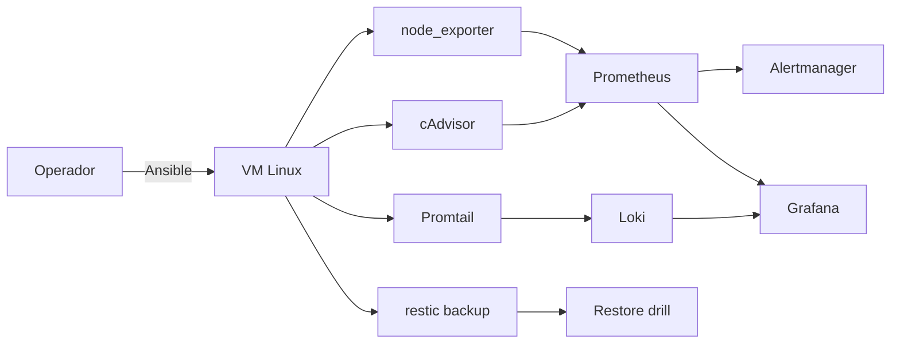

# Linux SRE Observability Kit

> **Estado:** 📝 Planificación — carpeta creada, sin código todavía.
>
> **Repo público previsto:** `estebanvizca/linux-sre-observability-kit`  
> **Licencia prevista:** MIT  
> **Idioma del README público:** inglés. Este documento es la especificación interna en español.

## 1. Resumen ejecutivo

Kit reproducible para convertir una VM Linux en un servidor observable, endurecido y recuperable. Incluye monitoreo con Prometheus/Grafana/Loki, alertas, backups, restauración documentada y un playbook de hardening con Ansible.

El proyecto demuestra algo que muchos CV no prueban: **dejar un servidor operable, no solo instalarlo**. La pregunta que responde es: “si este servidor falla, ¿sabes que falló, puedes recuperarlo y tienes un runbook?”

## 2. Problema

Los portafolios suelen mostrar aplicaciones desplegadas, pero no la operación: backups que nunca se restauran, alertas que nadie probó, firewalls mal documentados y servidores sin observabilidad. Este proyecto convierte la administración de servidores en evidencia reproducible.

## 3. Objetivo y resultado esperado

**Resultado esperado:** un repositorio que levante una VM Linux de laboratorio, aplique hardening y observabilidad, genere una alerta real, haga un backup y demuestre una restauración exitosa.

Al finalizar debe existir:

- VM o entorno de laboratorio reproducible.
- Playbook de hardening idempotente.
- Stack de observabilidad funcionando.
- Alertas probadas.
- Backup y simulacro de restauración.
- Runbooks y reporte de resultados.

## 4. Habilidades que demuestra

- Administración de Linux: usuarios, SSH, servicios, logs, disco y red.
- Seguridad operativa: firewall, fail2ban, permisos, actualizaciones.
- Infraestructura como código: Ansible.
- Observabilidad: Prometheus, Grafana, Loki, Alertmanager, exporters.
- Backups y recuperación: restic, restauración verificada.
- Documentación operativa: runbooks, checklist, decisiones.
- Troubleshooting: diagnóstico guiado por métricas y logs.

## 5. Alcance del MVP

### Incluido

- VM Rocky Linux 9 o Ubuntu Server (una sola).
- Aprovisionamiento local con Vagrant/VirtualBox o instrucciones para una VM existente.
- Playbook Ansible para:
  - usuario administrador y claves SSH;
  - desactivar login de root por contraseña;
  - firewall con nftables/ufw;
  - fail2ban;
  - actualizaciones de seguridad;
  - zona horaria, NTP y límites básicos.
- Docker Compose para:
  - Prometheus;
  - Grafana;
  - Loki + Promtail;
  - Alertmanager;
  - node_exporter;
  - cAdvisor.
- Alertas de CPU, disco, memoria, servicio caído y certificados.
- Backup con restic a almacenamiento local o compatible con S3.
- Script de simulacro de restauración.
- Runbooks de incidentes.

### Fuera del MVP

- Cluster Kubernetes.
- Infraestructura multi-región.
- Pentesting ofensivo.
- Datos de producción.
- Prometheus HA o Thanos.
- Cumplimiento CIS completo certificado.

## 6. Arquitectura



## 7. Stack previsto

| Capa | Tecnología |
|---|---|
| Sistema | Rocky Linux 9 / Ubuntu Server |
| Automatización | Ansible |
| Contenedores | Docker + Docker Compose |
| Métricas | Prometheus, node_exporter, cAdvisor |
| Logs | Loki, Promtail |
| Visualización | Grafana |
| Alertas | Alertmanager |
| Backups | restic |
| Seguridad | nftables/ufw, fail2ban, SSH |
| Pruebas | pytest, scripts de verificación |

## 8. Estructura prevista del repositorio

```text
linux-sre-observability-kit/
├── README.md
├── LICENSE
├── Makefile
├── Vagrantfile
├── ansible/
│   ├── inventory/
│   ├── group_vars/
│   ├── roles/
│   │   ├── common/
│   │   ├── hardening/
│   │   ├── docker/
│   │   └── backup/
│   └── playbooks/
├── monitoring/
│   ├── docker-compose.yml
│   ├── prometheus/
│   ├── grafana/
│   ├── loki/
│   └── alertmanager/
├── scripts/
│   ├── backup.sh
│   ├── restore-drill.sh
│   └── verify.sh
├── tests/
│   ├── test_hardening.py
│   ├── test_services.py
│   └── test_backup_restore.py
├── docs/
│   ├── architecture.md
│   ├── runbook.md
│   ├── security-checklist.md
│   └── results.md
└── .github/workflows/ci.yml
```

## 9. Flujo de uso previsto

1. `make vm`: crea la VM de laboratorio.
2. `make provision`: aplica Ansible.
3. `make monitoring`: levanta Prometheus/Grafana/Loki.
4. `make verify`: comprueba servicios, firewall y alertas.
5. `make backup`: ejecuta un backup.
6. `make restore-drill`: restaura en un directorio aislado y verifica.
7. `make destroy`: elimina el laboratorio.

## 10. Hardening mínimo

- SSH solo con claves.
- Root sin login remoto por contraseña.
- Firewall con solo los puertos necesarios.
- fail2ban activo para SSH.
- Actualizaciones de seguridad automáticas.
- Usuario de aplicación sin privilegios.
- Permisos correctos en directorios de backup.
- Secretos fuera del repositorio.
- Logs con retención definida.

No se afirmará “CIS compliant”. Se dirá “hardening inspirado en buenas prácticas, con checklist verificable”.

## 11. Pruebas y criterios de aceptación

### Pruebas mínimas

- El playbook es idempotente: la segunda ejecución no cambia nada.
- SSH con contraseña está deshabilitado.
- El firewall bloquea un puerto no permitido.
- fail2ban bloquea intentos fallidos de SSH.
- Prometheus ve todos los targets.
- Grafana carga el dashboard.
- Una alerta de prueba llega a Alertmanager.
- Loki recibe logs.
- El backup se crea y se puede restaurar.
- El restore drill verifica checksums o contenido.

### Criterios de aceptación

- `make vm && make provision && make verify` funciona desde un clon limpio en Linux.
- El entorno no requiere una cuenta cloud obligatoria.
- No hay secretos, claves privadas ni datos personales en el repositorio.
- El README incluye tiempos medidos de backup y restauración.
- Los runbooks permiten resolver los incidentes simulados.
- Se documenta claramente que es un laboratorio.

## 12. Métricas que se reportarán

- Tiempo de aprovisionamiento.
- Tiempo hasta que una alerta llega a Alertmanager.
- Tiempo de backup.
- Tiempo de restauración y resultado de verificación.
- Número de puertos abiertos antes/después.
- Resultado del checklist de hardening.

Las cifras se medirán en la ejecución final; no se publicarán estimaciones como resultados.

## 13. Demo prevista

- GIF o vídeo de 60–90 segundos:
  1. VM levantada.
  2. Dashboard de Grafana.
  3. Alerta de CPU/disco.
  4. Backup y restauración.
- Capturas de Grafana y Alertmanager.
- Diagrama de arquitectura.

## 14. Plan de implementación

| Fase | Entregable | Tiempo estimado |
|---|---|---:|
| 0 | VM y estructura | 1 día |
| 1 | Playbook common + hardening | 2 días |
| 2 | Docker y stack de observabilidad | 2 días |
| 3 | Alertas y dashboards | 1–2 días |
| 4 | Backups y restore drill | 1–2 días |
| 5 | Tests y runbooks | 1–2 días |
| 6 | README y publicación | 1 día |

**Total realista:** 7–10 días. Un MVP sin Loki puede salir en 4–5 días.

## 15. Seguridad y privacidad

- Ejecutar solo en una VM local o de laboratorio.
- No usar el playbook contra un servidor real sin revisar cada tarea.
- No incluir claves privadas, tokens ni contraseñas.
- Generar secretos locales con un script y añadirlos a `.gitignore`.
- Documentar el modelo de amenaza y los límites.
- No presentar el hardening como auditoría de seguridad certificada.

## 16. Riesgos y mitigaciones

| Riesgo | Mitigación |
|---|---|
| Romper la VM anfitriona | Usar VM y snapshots |
| Ansible no idempotente | Probar dos ejecuciones y corregir |
| Stack de observabilidad pesado | Perfil mínimo con Prometheus + Grafana |
| Backups que nunca se restauran | Restore drill obligatorio |
| Secretos en Git | `.gitignore`, variables de entorno y revisión previa |

## 17. README público previsto

- Problema y resultado.
- Arquitectura.
- Requisitos.
- Quickstart.
- Checklist de hardening.
- Alertas y runbooks.
- Resultados medidos.
- Límites y seguridad.
- Licencia.

## 18. Mapeo a puestos de trabajo

- SRE / Site Reliability Engineer junior.
- Linux Systems Administrator.
- Infrastructure Engineer.
- DevOps junior.
- Technical Support Engineer con Linux.
- Observability Engineer.

## 19. Extensiones futuras

- Segundo host y alta disponibilidad.
- Terraform para una VM cloud.
- Wazuh para detección de intrusos.
- k6 para pruebas de carga.
- Alertas por Telegram/Slack.
- Comparación de costos entre VPS.
